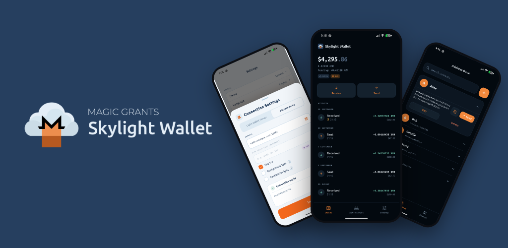

# Skylight Wallet



A modern, open-source, and self-custody Monero light-wallet built with Flutter by [MAGIC Grants](https://magicgrants.org).

On Android, the optional Background sync and Continuous sync use your view key only: they see incoming payments, but never hold a key that could spend.

**Website:** [skylight.magicgrants.org](https://skylight.magicgrants.org)

Looking for Bitcoin, Ethereum, and Dai too? [Spice Wallet](https://github.com/MAGICGrants/spice-wallet) is MAGIC Grants' multicoin wallet, built on the same wallet engine.


## Install

<div align="center">

[](https://apps.apple.com/us/app/skylight-wallet-for-monero/id6759176050)
[](https://play.google.com/store/apps/details?id=org.magicgrants.skylight)
[](https://f-droid.org/en/packages/org.magicgrants.skylight/)

</div>

Android APKs are also available from the [latest release](https://github.com/MAGICGrants/skylight-wallet/releases/latest).

### Requirements

- **iOS:** iOS 16 or later.
- **Android:** Android 7.0 (API 24) or later.
- **macOS:** macOS 13 Ventura or later, on Apple silicon. There is no macOS release yet; build from source.
- **Windows:** Windows 10 or 11, 64-bit. Security keys need Windows 11, version 22H2 or later.
- **Linux:** 64-bit (x86_64). Security keys need libfido2 (`libfido2-1`, which the ``.deb`` recommends).

### Desktop

#### Linux

Download from [latest release](https://github.com/MAGICGrants/skylight-wallet/releases/latest), ``.AppImage`` to run on any distribution, ``.deb`` for Debian.

#### Windows

Download from [latest release](https://github.com/MAGICGrants/skylight-wallet/releases/latest) the ``.exe`` file.

### Verify release signatures

Each release artifact has a detached GPG signature (``.asc``). Verify downloads before installing. This applies to all signed files (``.deb``, ``.AppImage``, ``.exe``, ``.apk``, ``.aab``, etc.).

**1. Import the signing key** (one-time):

```bash
curl -LO https://magicgrants.org/files/app-signing-key.asc
gpg --import app-signing-key.asc
```

Confirm the fingerprint matches:

```
65C4 1CFC AE37 B3B2 72AC  40BE A555 F5F7 B1FF 5885
```

```bash
gpg --fingerprint '65C4 1CFC AE37 B3B2 72AC  40BE A555 F5F7 B1FF 5885'
```

The key owner should be `MAGIC Grants <info@magicgrants.org>`.

**2. Download the artifact and its signature** from the release page. Example for v1.0.10 on amd64:

```bash
curl -LO https://github.com/MAGICGrants/skylight-wallet/releases/download/v1.0.10/skylight-wallet-v1.0.10-amd64.deb
curl -LO https://github.com/MAGICGrants/skylight-wallet/releases/download/v1.0.10/skylight-wallet-v1.0.10-amd64.deb.asc
```

**3. Verify the signature**:

```bash
gpg --verify skylight-wallet-v1.0.10-amd64.deb.asc skylight-wallet-v1.0.10-amd64.deb
```

A successful verification prints `Good signature from "MAGIC Grants <info@magicgrants.org>"`. Substitute the artifact and ``.asc`` filenames for other platforms (e.g. ``.AppImage``, ``.exe``, ``.apk``).

## Prerequisites

Before you begin, ensure you have the following installed:

- **Flutter SDK** (3.47.7, the version pinned in `pubspec.yaml`) - [Installation guide](https://docs.flutter.dev/get-started/install)
- **Dart SDK** (3.13.5) - Comes with Flutter
- **Android Studio** - For Android development
- **Android SDK** - API level 24+ (Android 7.0 or higher)
- **Java JDK** - Version 17
- **Xcode** (26 or later) and **CocoaPods** (1.17) - For iOS and macOS builds

## Getting Started

### 1. Clone the Repository

```bash
git clone https://github.com/magicgrants/skylight-wallet.git
cd skylight-wallet
```

### 2. Install Dependencies

```bash
flutter pub get
```

### 3. Configure Android Development Environment

1. **Install Android Studio** and the Android SDK
2. **Accept Android licenses**:
   ```bash
   flutter doctor --android-licenses
   ```
3. **Set up a device**:
   - Use an Android emulator (AVD Manager in Android Studio), or
   - Connect a physical Android device with USB debugging enabled
4. **Verify setup**:
   ```bash
   flutter doctor
   ```
   This will check for any missing dependencies

## Development

### Running the App

#### Debug Mode (Development)

Run the app in debug mode with hot reload:

```bash
# Run on connected device or emulator
flutter run

# List available Android devices/emulators
flutter devices

# Run on a specific device
flutter run -d <device_id>
```

Make sure you have an Android emulator running or a physical device connected before running the app.

### Memory safety settings

The release builds turn on the platforms' strictest native-memory checks, for
the C and C++ in the app (the Flutter engine, Monero, Tor, FHSE):

- **Android** (`android/app/src/main/AndroidManifest.xml`): Arm MTE in sync
  mode (Pixel 8 and later, when MTE is on), GWP-ASan on every launch, and
  zeroed heap allocations.
- **iOS and macOS** (`Runner.entitlements`, `Release.entitlements`): the
  hardened process with a hardened heap, and Memory Integrity Enforcement
  (hardware memory tagging on A19 iPhones and M5 Macs) enforced rather than
  in soft mode.

These stop a use-after-free or overflow at the faulting access. The cost is
that a latent heap bug in any of that native code, harmless elsewhere, ends
the app on that hardware, unlock included. A crash there that does not happen
on other devices points here first: the crash report names a tag mismatch or
GWP-ASan.

## Building for Android

### Debug APK

Build a debug APK for testing:

```bash
flutter build apk --debug
```

The APK will be located at: `build/app/outputs/flutter-apk/app-debug.apk`

### Release APK

Build a debug APK for release:

```bash
flutter build apk --release
```

The APK will be located at: `build/app/outputs/flutter-apk/app-release.apk`

#### Split APKs by ABI (smaller file sizes)

```bash
flutter build apk --split-per-abi --release
```

This creates separate APKs for each architecture:
- `app-armeabi-v7a-release.apk` (32-bit ARM)
- `app-arm64-v8a-release.apk` (64-bit ARM)
- `app-x86_64-release.apk` (64-bit x86)

### Installing the APK

To install the built APK on your device:

```bash
# Install debug APK
flutter install

# Or manually using adb
adb install build/app/outputs/flutter-apk/app-release.apk
```

**Note**: These steps cover building for Android. Skylight Wallet is also available for iOS, macOS, Linux, and Windows.

## Localization

The app uses Flutter's internationalization framework. To add a new language:

1. Create a new ARB file in `lib/l10n/` (e.g., `app_es.arb` for Spanish)
2. Copy the structure from `app_en.arb` and translate the strings
3. Run code generation:
   ```bash
   flutter gen-l10n
   ```
4. The generated localization files will be in `lib/l10n/`

## Building `libmonero_libwallet2_api_c.so`

This is needed for the wallet functions and is located at `android/app/src/main/jniLibs/<platform>/`.

These instructions should work on Ubuntu 22.04. You can use the `ubuntu:22.04` Docker image if you don't use Ubuntu as your OS.

### Install dependencies

```bash
$ apt update
$ apt install -y build-essential pkg-config autoconf libtool \
    ccache make cmake gcc g++ git curl lbzip2 libtinfo5 gperf \
    unzip python-is-python3 llvm
```

### Prepare source

```bash
$ git clone https://github.com/vtnerd/monero_c --recursive
$ cd monero_c
$ git checkout lwsf
$ git submodule update --init
$ ./apply_patches.sh monero
```

### Building

```bash
# For armeabi-v7a
$ ./build_single.sh monero armv7a-linux-androideabi -j$(nproc)

# For arm64-v8a
$ ./build_single.sh monero aarch64-linux-android -j$(nproc)

# For x86_64
$ ./build_single.sh monero x86_64-linux-android -j$(nproc)
```

## Contributing

Pull requests welcome! Thanks for supporting MAGIC Grants.

To join our Matrix community, [click here](https://matrix.to/#/#skylight-wallet:monero.social).

## License

[MIT](LICENSE)
